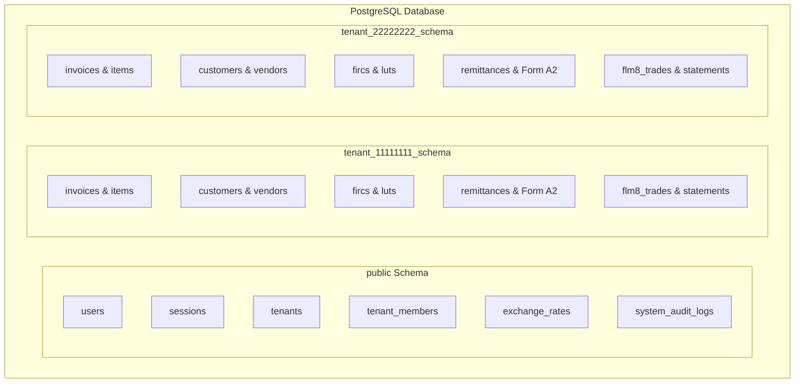
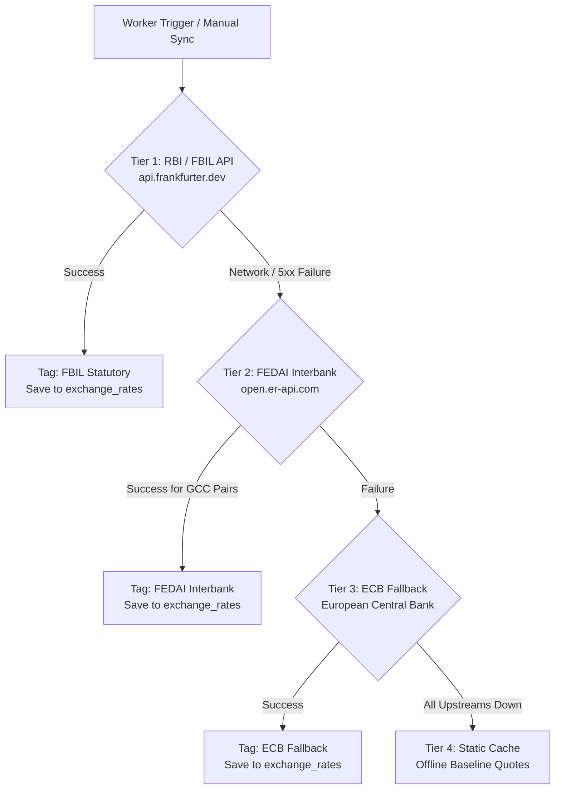

# VaultBill — System Architecture & Technical Specifications

This document outlines the architectural blueprint, data boundaries, multi-tenancy models, and statutory computation engines powering **VaultBill**.

---

## 1. System Topology & Monorepo Boundaries

VaultBill is organized as an enterprise-grade Turborepo monorepo enforcing strict boundary separation across apps and packages:

```text
                            ┌────────────────────────────────────────┐
                            │          Next.js 14 Frontend           │
                            │               (apps/web)               │
                            │   Port: 3000 | App Router | Tailwind   │
                            └───────────────────┬────────────────────┘
                                                │
                                      HTTP / tRPC (v10/v11)
                                      Session Cookie Auth
                                                │
                                                ▼
┌────────────────────────────────────────────────────────────────────────────────────┐
│                                Fastify API Server                                  │
│                                    (apps/api)                                      │
│                                    Port: 3001                                      │
│                                                                                    │
│   ┌─────────────────────┐   ┌──────────────────────────┐   ┌───────────────────┐   │
│   │ Better Auth Engine  │   │   tRPC Router Matrix     │   │ Dynamic Tenant DB │   │
│   │  (Session & Roles)  │   │ (Invoices, Forex, Compliance)│   │  Context Scoper   │   │
│   └──────────┬──────────┘   └─────────────┬────────────┘   └─────────┬─────────┘   │
└──────────────┼────────────────────────────┼──────────────────────────┼─────────────┘
               │                            │                          │
               │                            │ Dispatches Jobs          │
               ▼                            ▼                          │
┌──────────────────────────────┐   ┌──────────────────────────────┐    │
│    PostgreSQL 16 Engine      │   │        Redis 7 Store         │    │
│         Port: 5434           │   │          Port: 6380          │    │
│                              │   │   BullMQ Task Queues         │    │
│  [ public schema ]           │   └──────────────┬───────────────┘    │
│   • users, sessions, tenants │                  │                    │
│   • global exchange_rates    │                  │ Consumes Jobs      │
│   • system audit logs        │                  ▼                    │
│                              │   ┌──────────────────────────────┐    │
│  [ tenant_{id} schemas ]     │   │     BullMQ Worker Daemon     │    │
│   • invoices & items         │   │        (apps/worker)         │    │
│   • customers & vendors      │   │ • 4-tier Forex rate sync     │    │
│   • fircs, luts, remittances │   │ • FEMA 270-day aging sweep   │    │
│   • flm-8 foreign cash ledger│   │ • Scheduled automated backup │    │
└──────────────▲───────────────┘   └──────────────┬───────────────┘    │
               │                                  │                    │
               └──────────────────────────────────┴────────────────────┘
                                                  │
                                                  │ Streams Rendered PDFs
                                                  ▼
                                   ┌──────────────────────────────┐
                                   │       MinIO S3 Storage       │
                                   │       Port: 9003 / 9004      │
                                   │  • Invoice PDFs & Receipts   │
                                   │  • FIRC & LUT scan uploads   │
                                   │  • Tenant logos & backups    │
                                   └──────────────────────────────┘
```

### Monorepo Responsibility Matrix

| Artifact          | Type             | Role & Boundaries                                                                                   |
| ----------------- | ---------------- | --------------------------------------------------------------------------------------------------- |
| `apps/web`        | Next.js 14 App   | React client, Server Components, design system, theme tokens, tRPC client queries & mutations.      |
| `apps/api`        | Fastify Server   | tRPC endpoint, Better Auth handlers, request authentication hooks, tenant schema resolver.          |
| `apps/worker`     | BullMQ Worker    | Headless Node.js process executing background jobs: rate syncing, FEMA monitoring, backup exports.  |
| `packages/db`     | Internal Package | Drizzle ORM schemas, migration scripts, PostgreSQL connection pool, tenant schema provisioner.      |
| `packages/shared` | Internal Package | Shared Zod schemas, stateless tax calculation engines (GST, TCS, FLM-8), date & currency utilities. |
| `packages/pdf`    | Internal Package | Headless Puppeteer engine, HTML/CSS invoice templates (5 archetypes), Form A2 RBI generator.        |
| `packages/config` | Internal Package | Validated environment schema (`loadEnv()`), statutory thresholds, RBI purpose code directories.     |

---

## 2. Multi-Tenancy Architecture: PostgreSQL Schema-Per-Tenant

VaultBill strictly isolates tenant data at the database layer using PostgreSQL's native schema mechanism. Rather than relying on fragile row-level `WHERE tenant_id = ?` filters that risk accidental data leaks, each workspace is given its own physically distinct schema: `tenant_{uuid}`.



### 1. Public Schema (`public`)

Maintains global, platform-wide identity, routing, and shared reference data:

- `users`: Core user accounts (email, password hash, personal profile, avatar).
- `sessions`: Better Auth active session tokens and revocation state.
- `tenants`: Registered business workspaces, slug, creation metadata.
- `tenant_members`: User-to-tenant memberships with role-based access control (`owner`, `admin`, `member`, `accountant`).
- `exchange_rates`: Global RBI/FBIL & FEDAI currency rates historical repository.
- `system_audit_logs`: Global security and authentication telemetry.

### 2. Tenant Schemas (`tenant_{tenantId}`)

Dynamically provisioned during workspace creation via `packages/db/src/provision.ts`.

- `invoices`: Master invoice records (invoice number, issue date, due date, status, currency, exchange rate snapshot, total amounts).
- `invoice_items`: Granular invoice lines, HSN/SAC codes, quantities, unit prices, GST rates.
- `customers` & `vendors`: Entity master directories with PAN, GSTIN, billing/shipping addresses, and SWIFT details.
- `luts`: GST Letter of Undertaking registrations, validity dates, and MinIO document keys.
- `fircs`: Foreign Inward Remittance Certificates, issuing bank, currency, amount, and unmapped balance tracker.
- `remittances`: Outbound foreign transfers under LRS, purpose codes, TCS computations, Form A2 declarations.
- `forex_trades` & `flm8_statements`: Physical currency transactions and monthly FFMC reconciliation sheets.

### 3. Request Resolution & Context Injection

When a request enters the Fastify API:

1. `authMiddleware` validates the session cookie against the `sessions` table in `public`.
2. Resolves active `tenantId` from header `x-tenant-id` or user's active membership.
3. Invokes `createTenantDb(tenantId)` which yields a Drizzle ORM client configured with search path:
   ```sql
   SET search_path TO "tenant_<tenant_id>", public;
   ```
4. Injects `ctx.tenantDb` into the tRPC context. Every mutation or query inside that procedure operates exclusively on that tenant's tables.

---

## 3. Statutory RBI/FBIL Forex Engine (4-Tier Fallback)

To eliminate forex disputes and meet statutory requirements for balance sheet conversion, export billing, and customs valuation, VaultBill implements a resilient 4-Tier synchronization hierarchy:



### Forex Notation Standard

VaultBill enforces the **Indian Financial Standard Notation**:
$$\text{Rate} = \text{Price of 1 Unit of Foreign Currency in Indian Rupees (INR)}$$
Examples:

- `1 USD = ₹86.85`
- `1 EUR = ₹94.40`
- `1 GBP = ₹110.15`
- `1 AED = ₹23.65`

### Provider Matrix

| Tier       | Provider   | Governing Authority                   | Currencies Covered                                          | Role                                                                           |
| ---------- | ---------- | ------------------------------------- | ----------------------------------------------------------- | ------------------------------------------------------------------------------ |
| **Tier 1** | **FBIL**   | Reserve Bank of India (RBI)           | USD, EUR, GBP, JPY, AUD, CAD, CHF, SGD, NZD, SEK, NOK, etc. | Official reference rates for customs, export realization, and statutory books. |
| **Tier 2** | **FEDAI**  | Foreign Exchange Dealers' Association | AED, SAR, KWD, QAR, OMR, BHD                                | Gulf / GCC currency interbank rates adhering to FEMA Rule 7.                   |
| **Tier 3** | **ECB**    | European Central Bank                 | Global majors                                               | International liquidity resilience fallback.                                   |
| **Tier 4** | **Static** | Offline Snapshot                      | 25+ Pre-seeded pairs                                        | Zero-downtime fail-safe baseline.                                              |

---

## 4. Statutory Regulatory Engines & Mathematical Formulations

### 1. GST & Zero-Rated Export Rules (`packages/shared/src/gst.ts`)

- **State Code Resolution**: The first 2 digits of the 15-character GSTIN identify the Indian State/UT code (e.g. `27` = Maharashtra, `29` = Karnataka, `07` = Delhi).
- **Tax Classification**:
  - **Export with LUT**:
    $$\text{CGST} = 0, \quad \text{SGST} = 0, \quad \text{IGST} = 0$$
  - **Intra-State Supply** ($\text{State}_{\text{supplier}} = \text{State}_{\text{customer}}$):
    $$\text{CGST} = \text{Amount} \times \frac{\text{Rate}}{200}, \quad \text{SGST} = \text{Amount} \times \frac{\text{Rate}}{200}, \quad \text{IGST} = 0$$
  - **Inter-State Supply** ($\text{State}_{\text{supplier}} \neq \text{State}_{\text{customer}}$):
    $$\text{CGST} = 0, \quad \text{SGST} = 0, \quad \text{IGST} = \text{Amount} \times \frac{\text{Rate}}{100}$$

### 2. FEMA 270-Day Realization Clock (`apps/worker/src/jobs/fema-check.ts`)

Under Section 7 of the Foreign Exchange Management Act (FEMA), 1999 read with Foreign Exchange Management (Export of Goods and Services) Regulations, exporters must realize full export proceeds within **9 months (270 days)** from the invoice date.

$$\text{Age} = \text{Current Date} - \text{Invoice Date}$$

- $\text{Age} < 180 \text{ days}$: **Compliant (Green)** — Normal trade window.
- $180 \le \text{Age} < 240 \text{ days}$: **Warning (Amber)** — Proactive realization alerts dispatched to finance teams.
- $\text{Age} \ge 240 \text{ days}$: **Critical (Red)** — Immediate escalation required to prevent EDPMS / RBI cautionary listing.

### 3. LRS & Income Tax Section 206C(1G) TCS Engine (`packages/shared/src/tcs.ts`)

Outbound foreign transfers under the Liberalised Remittance Scheme (LRS) are capped at **$250,000 USD** per financial year per PAN. Tax Collected at Source (TCS) applies above the statutory threshold:

$$\text{TCS Threshold} = ₹7,00,000 \text{ INR}$$

$$\text{Taxable Remittance} = \max\left(0, \min(\text{Current Remittance}, (\text{Cumulative FY Total} + \text{Current Remittance}) - 7,00,000)\right)$$

| Purpose Category                  | TCS Rate | Statutory Provision        |
| --------------------------------- | -------- | -------------------------- |
| Education (Funded via Bank Loan)  | `0.5%`   | Section 206C(1G)(a)        |
| Education / Medical (Self-Funded) | `5.0%`   | Section 206C(1G)(a)        |
| Overseas Asset Investment         | `20.0%`  | Finance Act 2023 amendment |
| Foreign Tour Package / Travel     | `20.0%`  | Finance Act 2023 amendment |
| Gifts / Maintenance / Other       | `20.0%`  | Section 206C(1G)(b)        |

### 4. FLM-8 Money Changer Balance Solver (`packages/shared/src/flm8.ts`)

Full-Fledged Money Changers (FFMC) and Authorized Dealers Category-II must submit monthly returns to the RBI reconciling physical currency note inventory:

$$\text{Closing Balance} = \text{Opening Balance} + \sum \text{Purchases} - \sum \text{Sales}$$

Transactions are strictly categorized according to RBI inspection standards:

- Purchases from Public / Foreign Tourists
- Purchases from other FFMC / Authorized Dealers
- Sales to Public (Private visits, Business travel, Medical)
- Surrender / Sales to Authorized Dealers

---

## 5. Document & PDF Generation Pipeline

Invoice and statutory report generation executes server-side via headless Puppeteer:

```
Invoice Data (tRPC)
        │
        ▼
Template Transformer (packages/pdf/src/templates)
  • modern.ts / executive.ts / classic.ts / minimal.ts / corporate.ts
  • formA2.ts
        │
        ▼
Puppeteer Browser Worker (Print to PDF Stream, A4, 0-margin headers)
        │
        ▼
MinIO S3 Client Upload
  • Key: tenants/{tenantId}/invoices/{invoiceNumber}.pdf
        │
        ▼
Pre-Signed URL Emitted for Secure Download
```

---

## 6. Security & Telemetry Architecture

1. **HttpOnly & SameSite Cookies**: Better Auth session tokens are isolated from JavaScript DOM access to eliminate XSS token theft.
2. **Schema-Level Query Jail**: Database operations run strictly against the scoped tenant schema. No customer or invoice query can cross workspace boundaries.
3. **Audit Trails**: Security actions (rate overrides, manual bank reconciliation, user invitations, role updates) write immutable records to `tenant_audit_logs`.
4. **Environment Sanitization**: All environment variables are validated at startup with strict Zod types in `@vaultbill/config`.
